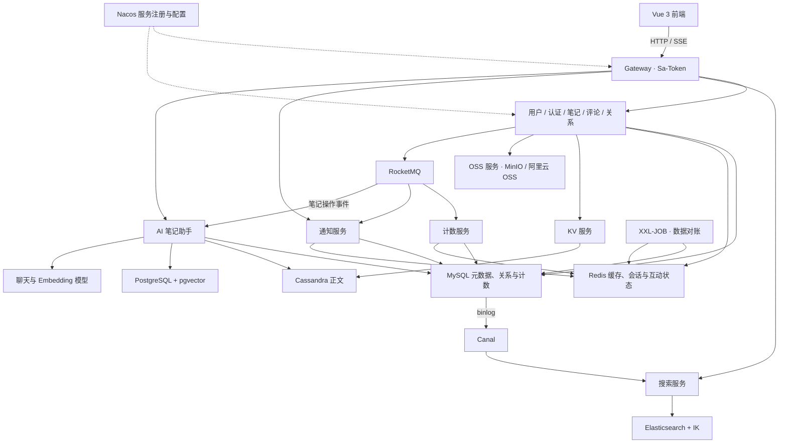

# 书亭

**记录生活，发现好内容。**

书亭是一个前后端分离的内容社区项目，采用 **Vue 3 + Spring Cloud Alibaba**，提供图文与视频笔记、评论互动、关注关系、关键词搜索、互动通知和 AI 笔记助手。前端兼顾桌面与移动端，后端以微服务组织业务，结合缓存、消息队列、搜索索引和向量检索实现内容浏览与社交互动。

源码中的 `xiaohashu` 模块名和 `com.quanxiaoha` 包名沿用现有工程命名。

## 目录

- [功能概览](#功能概览)
- [技术栈](#技术栈)
- [项目结构与服务](#项目结构与服务)
- [系统架构](#系统架构)
- [本地运行](#本地运行)
- [接口与验证](#接口与验证)
- [部署要点](#部署要点)
- [相关文档](#相关文档)

## 功能概览

| 功能 | 说明 |
| --- | --- |
| 账号与资料 | 手机验证码登录、密码登录、退出、修改密码、个人资料与头像编辑 |
| 内容发现 | 频道导航、响应式瀑布流、图文和视频详情；详情浮层关闭后保留列表位置 |
| 笔记创作 | 图文与视频发布、编辑、删除、置顶、可见性设置、频道与话题选择 |
| 社交互动 | 笔记点赞与收藏、评论与回复、图片评论、评论点赞 |
| 用户主页 | 已发布、收藏、点赞的笔记列表，关注与粉丝列表，关注与取关 |
| 内容搜索 | 笔记和用户搜索、关键词高亮、内容类型筛选、排序与发布时间筛选 |
| 互动通知 | 赞和收藏、评论和回复、新增关注三类列表，未读角标、已读同步、SSE 更新；点击可定位相关评论 |
| AI 笔记助手 | 自然语言检索站内笔记、生成带来源的回答、历史会话管理；后端另提供单篇笔记解读与流式接口 |

通知代码已实现，**通知消费与源事件捕获默认关闭**，需完成建表和配置后启用。AI 功能依赖可用的模型接口、向量库及笔记数据。

## 技术栈

版本来自当前依赖声明；中间件客户端版本不代表实际部署的服务端版本。

| 层次 | 主要技术 |
| --- | --- |
| 前端 | Vue 3.5、Vite 6、Vue Router 4、Pinia 3、Tailwind CSS 4、Axios、VueUse、GSAP |
| 主业务服务 | Java 17、Spring Boot 3.0.2、Spring Cloud 2022.0.0、Spring Cloud Alibaba 2022.0.0.0 |
| 服务治理 | Spring Cloud Gateway、Nacos、OpenFeign |
| 认证与基础组件 | Sa-Token 1.38.0、统一响应与异常处理、接口日志、登录上下文、内部接口凭证、接口幂等 |
| 数据存储 | MySQL、MyBatis、Druid、Redis、Cassandra；对象存储支持 MinIO 与阿里云 OSS |
| 缓存与消息 | Caffeine 3.1.8、Redis Lua / Bitmap / Bloom Filter、RocketMQ Spring Starter 2.2.3 / Client 4.9.4 |
| 搜索与任务 | Elasticsearch Java Client 7.3.0、IK 分词、Canal Client 1.1.7、XXL-JOB 2.4.1 |
| AI 服务 | Spring Boot 3.4.5、Spring AI 1.1.1、MyBatis-Plus 3.5.12、PostgreSQL + pgvector、通义千问兼容接口 |

**AI 模块独立管理依赖版本**：它参与后端 Maven 聚合构建，但不继承主工程的 Spring Boot / Spring Cloud 依赖管理。

## 项目结构与服务

主要源码目录如下：

```text
.
├── README.md
├── xiaohashu-vue3/                  # Vue 3 前端
│   ├── src/
│   │   ├── api/                    # 业务接口
│   │   ├── components/             # 笔记、评论、通知等组件
│   │   ├── composables/            # 瀑布流、SSE 与详情过渡
│   │   ├── router/                 # 页面与详情浮层路由
│   │   ├── stores/                 # Pinia 状态
│   │   └── views/                  # 发现、主页、搜索、通知、AI 页面
│   ├── tests/                      # 前端回归测试与展示夹具
│   └── vite.config.js
└── xiaohashu2/                     # Java 微服务后端
    ├── pom.xml                     # Maven 聚合工程
    ├── xiaoha-framework/            # 公共组件与 Spring Boot Starter
    ├── xiaohashu-gateway/           # API 网关
    ├── xiaohashu-auth/              # 认证
    ├── xiaohashu-user/              # 用户
    ├── xiaohashu-note/              # 笔记
    ├── xiaohashu-comment/           # 评论
    ├── xiaohashu-notification/      # 互动通知
    ├── xiaohashu-ai/                # AI 助手
    └── ...                         # 存储、关系、计数、搜索等服务
```

多数业务模块拆分为 `*-api`（DTO、Feign 契约）和 `*-biz`（业务实现及启动入口）。网关、认证和数据对账为单层服务。

| 模块 | 参考端口 | 职责 |
| --- | --- | --- |
| `xiaohashu-gateway` | 8000 | 路由转发、登录校验、用户身份透传 |
| `xiaohashu-oss` | 8081 / 8071 | 图片与视频等文件上传、对象存储策略 |
| `xiaohashu-user` | 8082 | 用户注册、资料查询与更新 |
| `xiaohashu-auth` | 8083 | 验证码与密码登录、退出、密码修改、短信发送 |
| `xiaohashu-kv` | 8084 | Cassandra 笔记正文与评论正文读写 |
| `xiaohashu-distributed-id-generator` | 8085 | Leaf 号段与 Snowflake 分布式 ID |
| `xiaohashu-note` | 8086 | 笔记管理、浏览、频道话题、点赞收藏 |
| `xiaohashu-user-relation` | 8087 | 关注关系与粉丝列表 |
| `xiaohashu-count` | 8088 | 用户和笔记互动计数、批量聚合落库 |
| `xiaohashu-ai` | 8090 | 语义检索、笔记解读与多轮会话 |
| `xiaohashu-data-align` | 8091 | XXL-JOB 分片任务、每日互动增量与计数校准 |
| `xiaohashu-search` | 8092 | 笔记与用户搜索、Canal 增量同步 |
| `xiaohashu-comment` | 8093 | 评论、回复、评论赞与目标评论定位 |
| `xiaohashu-notification` | 8094 | 通知列表、未读数、已读状态与 SSE |
| `xiaoha-framework` | — | 公共响应、Jackson、日志、上下文、幂等及通知 outbox |

端口以实际 `server.port` 及外部配置为准。OSS 已提交配置为 `8081`，当前本地工作区配置为 `8071`；AI 和通知的参考端口来自本地配置。

## 系统架构



### 登录与内容访问

网关校验 Sa-Token 登录态，清除外部传入的 `userId` 和内部凭证头，再透传可信用户身份。内部 `/internal/**` 查询使用独立的 `INTERNAL_API_TOKEN`；业务服务应由网关和受信网络入口访问。

笔记元数据存于 MySQL，正文经 KV 服务存于 Cassandra。详情结合 Caffeine 与 Redis 缓存，内容变更通过 MQ 驱动缓存失效。点赞、收藏等互动使用 Redis 数据结构和 Lua 判重，并通过 MQ 异步处理关系与计数。

### 搜索与 AI

搜索服务通过 Canal 订阅 MySQL binlog，将笔记、用户和计数变化同步至 Elasticsearch。AI 将笔记内容分块并向量化，通过 pgvector 召回候选，再由模型判优、获取正文并生成带来源的回答。没有相关笔记时，降级为通用 AI 回答并标识 `fromNotes=false`。

AI 支持笔记操作 MQ 增量索引、启动补齐与手工重建；是否启动补齐由部署配置决定。当前网关通过固定地址 `http://127.0.0.1:8090` 访问 AI 服务，AI 未接入 Nacos。

### 互动通知

通知覆盖笔记赞、评论赞、收藏、评论、回复、关注六类事件。收藏、关注、评论与回复使用本地事务 outbox；点赞使用独立消费组订阅原 MQ 正向事件。通知按业务键去重，以用户内序号分页和管理已读水位，SSE 提醒前端通过 REST 刷新列表与摘要。

## 本地运行

### 1. 环境与中间件

建议准备 **JDK 17、Maven 3.8+、Node.js 22 LTS 与 npm**。

| 范围 | 必要准备 |
| --- | --- |
| 社区基础功能 | MySQL、Redis、Nacos、RocketMQ、Cassandra、MinIO 或阿里云 OSS |
| 分布式 ID | MySQL `leaf_alloc` 表与业务标签；启用 Snowflake 时还需 ZooKeeper |
| 搜索 | Elasticsearch、兼容的 IK 插件、Canal、MySQL binlog 与索引 |
| 数据对账 | XXL-JOB 管理端、执行器和任务配置 |
| AI | PostgreSQL + pgvector、聊天和 Embedding 接口、AI 业务表及可检索笔记 |
| 通知 | 通知及源事件表、内部凭证、统一启用时间与开关 |

**当前仓库未提供完整主业务建库脚本、Cassandra 初始化脚本或一键部署方案。** 需要先准备匹配 Mapper 和数据模型的业务表、Leaf 数据及搜索索引，以下步骤以这些条件已满足为前提。

### 2. 获取代码与检查配置

```bash
git clone https://github.com/youchengcheng/shuting.git
cd shuting
```

主服务配置通常位于 `src/main/resources/config/`，网关配置位于 `src/main/resources/`。启动前检查数据库、Redis、Nacos、RocketMQ、对象存储、短信、Canal、XXL-JOB 的连接和凭证，并使服务发现的 namespace / group 一致。

配置的提交情况需要区分：

- 老业务服务的部分 YAML 与 `leaf.properties` 已被 Git 跟踪，需按实际环境修改或通过外部配置覆盖。
- `.gitignore` 忽略新增 YAML 与 Leaf 配置，**AI 和通知的本地 YAML 当前未提交**，克隆后需补齐对应运行配置。
- Leaf 使用 `java.util.Properties` 读取 `leaf.properties`，不能直接套用 Spring 的环境变量占位语法。
- 阿里云短信需要自己的访问凭证，并核对代码中的短信签名和模板。
- 搜索的 IK 热更新词典路径需指向部署环境中的实际文件。

内部查询需为调用方与服务端配置相同的 `INTERNAL_API_TOKEN`。AI 还需配置模型 API Key（现有配置使用 `DASHSCOPE_API_KEY`）、聊天模型、Embedding 模型及向量数据库连接。

### 3. 初始化扩展表

仓库提供以下 SQL，需在对应数据库中手工执行：

| 数据库 | 脚本 | 用途 |
| --- | --- | --- |
| MySQL 业务库 | [ai_module.sql](xiaohashu2/xiaohashu-ai/xiaohashu-ai-biz/src/main/resources/db/ai_module.sql) | AI 索引记录、笔记分析与会话表 |
| PostgreSQL | [vector_store.sql](xiaohashu2/xiaohashu-ai/xiaohashu-ai-biz/src/main/resources/db/vector_store.sql) | pgvector 扩展、向量表与 HNSW 索引 |
| 通知及源业务库 | [notification_module.sql](xiaohashu2/xiaohashu-notification/xiaohashu-notification-biz/src/main/resources/db/notification_module.sql) | 通知、用户状态、outbox 与错误隔离表 |
| 已有通知表所在库 | [notification_module_comments.sql](xiaohashu2/xiaohashu-notification/xiaohashu-notification-biz/src/main/resources/db/notification_module_comments.sql) | 补齐表与字段注释 |

向量表维度必须与 Embedding 输出一致，当前 SQL 使用 `1536`。通知表与各源服务的 outbox 应按实际数据库边界创建；共享业务库时无需重复建表。这些脚本不替代社区基础表的初始化。

### 4. 构建与启动后端

在仓库根目录进入后端工程：

```bash
cd xiaohashu2

# 全量构建：跳过测试编译与执行
mvn clean install "-Dmaven.test.skip=true"

# 或仅构建笔记服务及其依赖
mvn -pl xiaohashu-note/xiaohashu-note-biz -am install "-Dmaven.test.skip=true"
```

建议先启动中间件与 ID 服务，再启动用户、认证、KV、OSS，随后启动笔记、评论、关系、计数，最后启动网关。搜索、对账、AI 和通知按需要配置并启动。

可在 IDE 中运行各模块的 `*Application` 启动类，或在 `xiaohashu2` 目录运行构建后的 JAR。以下是两个独立启动示例，分别在各自终端中执行：

```bash
java -Duser.timezone=Asia/Shanghai -jar xiaohashu-note/xiaohashu-note-biz/target/xiaohashu-note-biz-0.0.1-SNAPSHOT.jar --spring.profiles.active=dev

java -Duser.timezone=Asia/Shanghai -jar xiaohashu-gateway/target/xiaohashu-gateway-0.0.1-SNAPSHOT.jar --spring.profiles.active=dev
```

网关默认入口为 `http://127.0.0.1:8000`。仅启动网关不能提供完整业务功能。

启用通知前需完成建表，配置相同的 `INTERNAL_API_TOKEN`、`notification.enabled-at` 和 `Asia/Shanghai` JVM 时区，再配合开启源服务 `notification.events.enabled` 与通知服务 `notification.enabled`。完整步骤见 [通知模块说明](xiaohashu2/xiaohashu-notification/README.md)。

### 5. 启动前端

在仓库根目录打开另一终端：

```bash
cd xiaohashu-vue3
npm ci
npm run dev
```

访问 Vite 输出的地址，通常为 `http://localhost:5173`。开发代理将 `/api/**` 转发至 `http://127.0.0.1:8000`，并移除 `/api` 前缀；后端地址变化时修改 [vite.config.js](xiaohashu-vue3/vite.config.js)。

## 接口与验证

登录后的请求使用 `Authorization: Bearer <token>`。以下为经网关访问的代表性接口，完整请求与响应可参考 [前端 API 封装](xiaohashu-vue3/src/api/) 和各服务 Controller。

| 方法 | 路径 | 说明 |
| --- | --- | --- |
| POST | `/auth/verification/code/send` | 发送验证码 |
| POST | `/auth/login` | 验证码或密码登录 |
| POST | `/note/publish` | 发布笔记 |
| POST | `/search/note` | 搜索笔记 |
| POST | `/search/user` | 搜索用户 |
| POST | `/notification/list` | 分类通知分页 |
| GET | `/notification/summary` | 未读摘要 |
| GET | `/notification/stream` | 通知 SSE |
| POST | `/ai/assistant/search` | 检索笔记并生成回答 |
| POST | `/ai/chat/send` | 保存会话的 AI 问答 |
| POST | `/ai/assistant/index/rebuild` | 重建 AI 索引 |

前端提供 Node 内置测试运行器，可在 `xiaohashu-vue3` 目录执行：

```bash
npm test
npm run build
```

测试覆盖通知状态、展示与跳转、个人主页和瀑布流逻辑。后端含依赖真实中间件的实验测试，全量构建跳过测试不代表验证通过；通知与 outbox 的定向验证方法见 [通知测试说明](xiaohashu2/xiaohashu-notification/xiaohashu-notification-biz/src/test/README.md) 和 [outbox 说明](xiaohashu2/xiaoha-framework/xiaoha-spring-boot-starter-notification-outbox/README.md)。

## 部署要点

- 前端执行 `npm run build` 后部署 `dist/`，为 Vue Router History 路由配置回退至 `index.html`。
- Vite 开发代理不会随构建发布；生产环境需将 `/api/**` 反向代理到网关并移除 `/api` 前缀。
- SSE 代理需关闭响应缓冲，并设置足够的读取与空闲超时。
- AI 当前使用网关固定地址路由，跨主机或容器部署时需同步调整目标地址。
- 按环境管理连接与凭证、Nacos namespace / group、服务端口和通知启用边界。

## 相关文档

- [AI 模块：检索流程、接口与配置](xiaohashu2/xiaohashu-ai/README.md)
- [通知模块：业务规则、投递与启用](xiaohashu2/xiaohashu-notification/README.md)
- [通知 outbox：事务与重试](xiaohashu2/xiaoha-framework/xiaoha-spring-boot-starter-notification-outbox/README.md)
- [内部接口凭证](xiaohashu2/xiaoha-framework/xiaoha-spring-boot-starter-biz-context/README.md)
- [前端测试与展示夹具](xiaohashu-vue3/tests/README.md)

## 许可证

仓库当前未提供 `LICENSE` 文件，尚未声明开源许可证。
